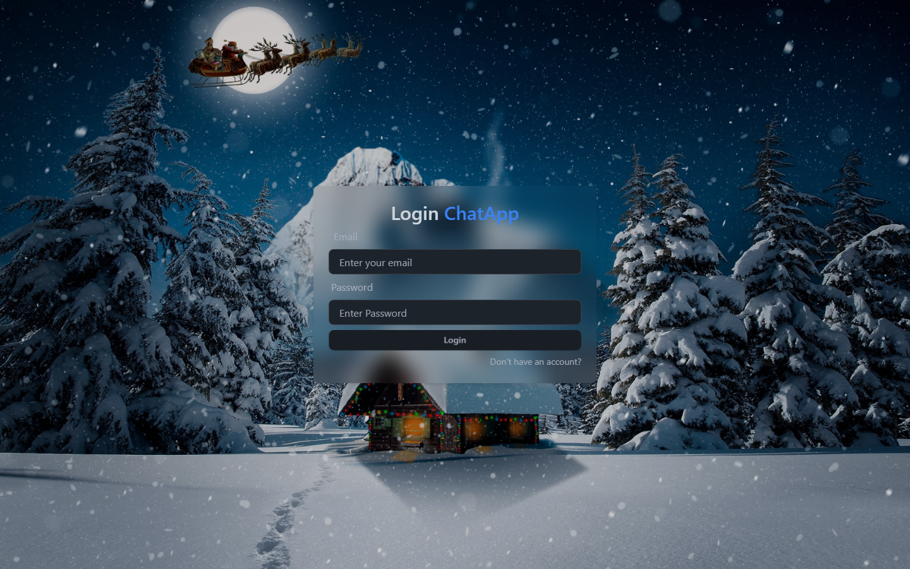
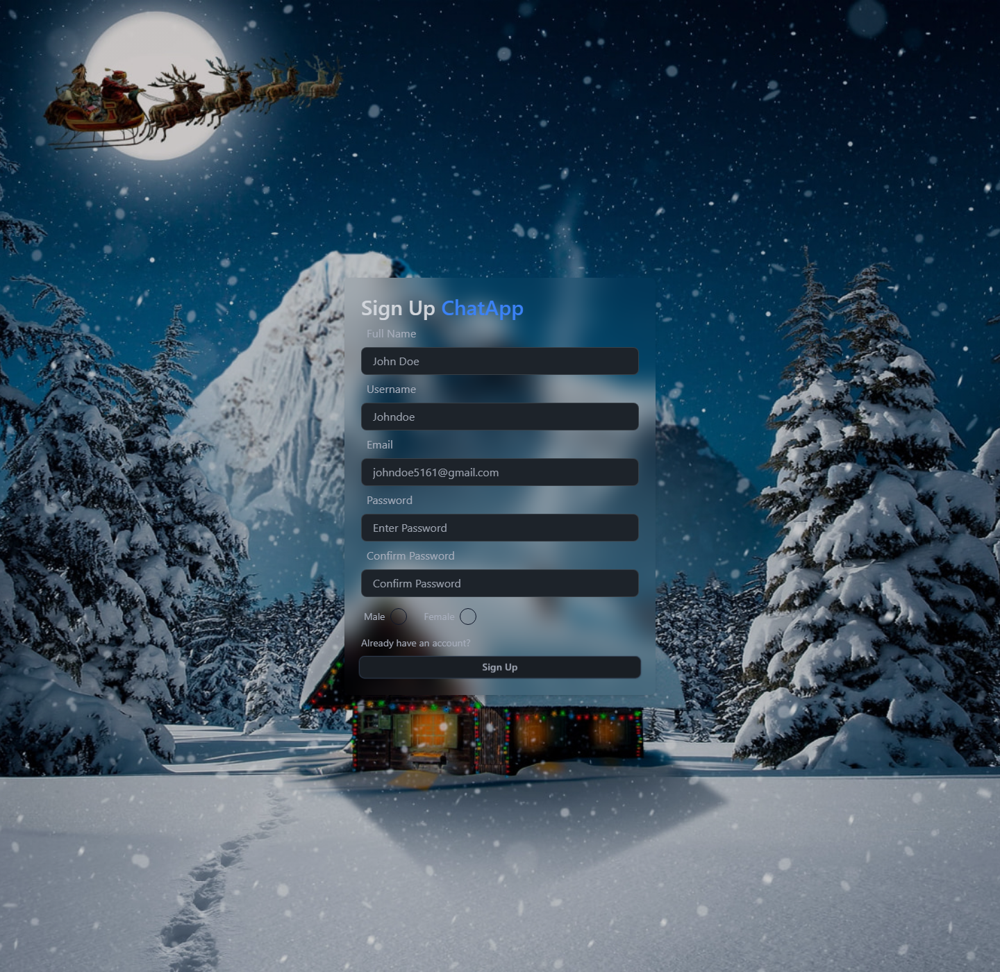
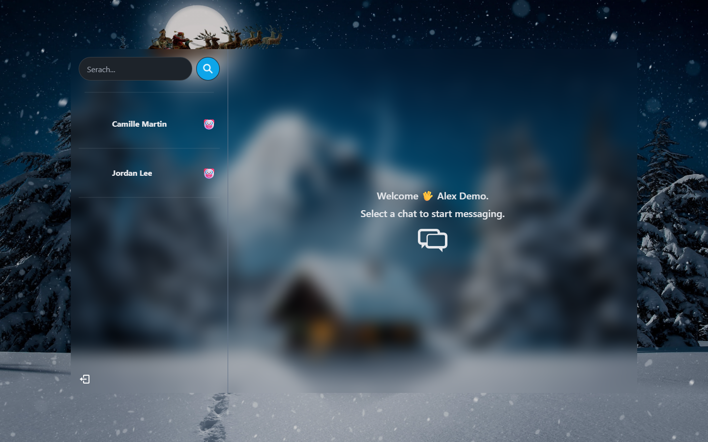

# Chat Conversation

Application web de messagerie en temps réel construite avec React, Express, Socket.IO et MongoDB.

## Captures d’écran

| Connexion | Création de compte |
| --- | --- |
|  |  |

### Messagerie



> La capture de la messagerie utilise des profils de démonstration fictifs. Aucune donnée ni aucun compte réel n’est inclus dans les images.

## Fonctionnalités

- Inscription, connexion et déconnexion avec authentification par cookie JWT.
- Liste des autres utilisateurs et sélection d’une conversation.
- Envoi et réception de messages en temps réel via Socket.IO.
- Interface responsive pour mobile, tablette et ordinateur.
- Déploiement du frontend et de l’API sur un même service Render.

## Technologies

- **Frontend :** React, Vite, Tailwind CSS, DaisyUI et Zustand.
- **Backend :** Node.js, Express et Socket.IO.
- **Base de données :** MongoDB avec Mongoose.
- **Authentification :** JSON Web Token (JWT), bcrypt et cookie HTTP-only.

## Prérequis

- Node.js 20.19+ et npm.
- Une base MongoDB accessible (par exemple MongoDB Atlas).

## Installation et démarrage local

Depuis la racine du dépôt :

1. Installez les dépendances :

   ```sh
   npm install
   npm install --prefix frontend
   ```

2. Créez le fichier `.env` à partir du modèle :

   ```sh
   cp .env.example .env
   ```

   Sous PowerShell, utilisez `Copy-Item .env.example .env`.

3. Renseignez les variables dans `.env` :

   | Variable | Description |
   | --- | --- |
   | `MONGO_URI` | URI de connexion à votre base MongoDB. |
   | `JWT_SECRET` | Secret long et aléatoire utilisé pour signer les jetons. |
   | `NODE_ENV` | Environnement d’exécution, par exemple `development`. |

4. Démarrez l’API et le serveur Socket.IO dans un premier terminal :

   ```sh
   npm run nodemon
   ```

5. Démarrez le frontend dans un second terminal :

   ```sh
   npm run dev --prefix frontend
   ```

   Ouvrez l’adresse locale indiquée par Vite, généralement `http://localhost:5173`.
   Le proxy Vite transmet les requêtes `/api` et `/socket.io` au serveur local sur le port `5000`.

Ne partagez jamais le fichier `.env` et ne commitez pas vos identifiants ou secrets.

## Commandes utiles

| Commande | Description |
| --- | --- |
| `npm run nodemon` | Démarre l’API en mode développement avec redémarrage automatique. |
| `npm start` | Démarre le serveur Node.js. |
| `npm run build` | Compile le frontend pour la production. |
| `npm run lint --prefix frontend` | Vérifie le code du frontend avec ESLint. |

Pour lancer l’application en mode production localement, compilez d’abord le frontend avec `npm run build`, puis lancez `npm start`. Express sert les fichiers générés dans `frontend/dist`.

## API

| Méthode | Route | Description | Authentification |
| --- | --- | --- | --- |
| `POST` | `/api/auth/signup` | Crée un compte. | Non |
| `POST` | `/api/auth/login` | Ouvre une session. | Non |
| `POST` | `/api/auth/logout` | Ferme la session. | Non |
| `GET` | `/api/users/checkAuth` | Vérifie la session courante. | Cookie JWT facultatif |
| `GET` | `/api/users/` | Récupère les autres utilisateurs. | Oui |
| `GET` | `/api/messages/:userId` | Récupère les messages avec un utilisateur. | Oui |
| `POST` | `/api/messages/send/:userId` | Envoie un message. | Oui |

Les messages reçus sont également transmis en temps réel par Socket.IO.

## Déploiement sur Render

Le dépôt inclut un fichier `render.yaml` configuré pour un déploiement Render Blueprint :

1. Poussez le dépôt sur GitHub sans y inclure `.env`.
2. Dans Render, créez un **Blueprint** et sélectionnez ce dépôt.
3. Fournissez `MONGO_URI` lorsque Render le demande. Pour MongoDB Atlas, vérifiez que les connexions provenant de Render sont autorisées.
4. Render génère `JWT_SECRET` automatiquement à partir du Blueprint.
5. Attendez la fin du déploiement, puis ouvrez l’URL du service.

Le Blueprint installe les dépendances, compile le frontend et démarre le serveur Express, qui sert également l’application web.

## Structure du dépôt

```text
backend/
  src/
    controllers/   Logique des routes API
    models/        Modèles MongoDB
    routes/        Routes d’authentification, utilisateurs et messages
    socket/        Serveur Socket.IO
frontend/
  src/
    components/    Composants de l’interface
    context/       Contexte Socket.IO
    pages/         Écrans de l’application
    store/         État global Zustand
docs/
  screenshots/     Captures d’écran de l’application
```
